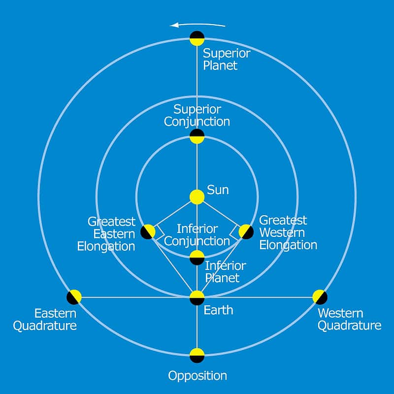

# The Night Sky
## Celestial Sphere
### Celestial sphere
#### Celestial Poles
We have **North Celestial Pole** and **South Celestial Pole**. The definition of poles is the points of earth's rotational axis points to at celestial sphere. If Earth's rotation axis were perfectly fixed relative to the distant stars, then we have fixed celestial poles, of course. However, our Earth's rotation axis slowly precesses, which means its direction in space slowly changes(actually circular around a point). The precession angles is around 23.5 degree which is exactly the angle between earth equator and celestial equator. This is not a coincident, this is phyiscs, we'll talk about this latter. Anyway, this also means the poles point aren't fixed, they are changed, although very slow, take about 26000 years per round.

                 ★
            .         .
         .               .
       ★        ●          ★
         .               .
            .         .
                 ★

                 ● = North Ecliptic Pole
                 ★ = possible positions
                     of North Celestial Pole

> [!NOTE]
> One thing you should notice here. Earth and celestial sphere only share the pole direction(north and south), but not the motion. This means Earth is self-rotating but celestial sphere isn't self-rotating with earth. Conceptually, it's what it is.


#### Precession, Angular momentum and Torque
In ancient era, people had already found "Precession of the Equinoxes", althought they don't know why it does. The word "precession" is from "precede" which means something happens before we predicted it should do. And the word "equinox" is also from latin which is "equi+nox" means equal night means the time range of day and night are the roughly same(In chinese, it is just "春(秋)分"). 

In 1687, Newton used his math and physics mechanics to explain the reason of this "precession" by using earth's self-spinning axis changes because of angular momentum and toque. From then on, people call the motion like that "precession".

The detail of how precession works is about angular momentum and torque which is highly used in **rigid body**. The reason is that rigid body has constrains for every points of mass in the body, so it's okay to treat it as a single thing(just as like you see a single mass point, not see it as many distributed mass points). It follows two basic physics laws(actually only one, but we say two here for convenient) momentum law and angular momentum law. For example, if the spinning axis of a spinning toy which has fixed rotation pivot point and rigid body properties, has an angle between z-axis, intuitively, we think it should fall down by gravity. However, the truth is that because the gravity does a torque which direction is always horizontal to ground and also perpendicular to angular momentum of the toy, you'll find that it only changes angular momentum by horizontal direction which makes the toy never fall down and keep circulate by z-axis. 

The key idea is that the definition of torque is $dL/dt$ which is changing angular momentum per time. To comprehend this idea, you need to consider why angular velocity and angular acceleration can be treated as vectors. First of all, velocity and accerelation for linear motion can be treated as vectors, you can easily understand this by thinking they can be discomposed by x and y components.  For example, a velocity (1, 1), you can discompose it as (1, 0)+(0, 1) which means the moving effect of (1, 1) can be seen as moving in x direction at speed of 1 plus moving in y direction at speed of 1.

Can angular velocity and accerelation does that? In the case of angular, You can take the similar example, an angular velocity rotate around (1, 1) which is with magnitude and direction, you can discompose it as (1, 0)+(0, 1) which means the rotation effect can be seen as rotation disk (1, 1) discompose as rotation disk (1, 0) plus roation disk (0, 1). The idea of Projection of (1, 1) rotation disk to x-axis and y-axis. If angular speed hold vector properties this way, then angular acceleration does the same. 

Use this idea to deal with precession, you can get deeply what happens about spinning toy's precession. For example, suppose we have a particle circulate (0, 0, 0) with angular momentum (1, 0, 0), and suddenly, if we have an angular acceraltion or a torque $\tau$ (0, 0, a) on it instantly, which is perpendicular to (1, 0, 0), then the magnittude of particle circulation would tend to be constant but change the direction. If $\tau$ is always perpendicular to the particlar circulation, then you would see it the circulation itself rotates y axis.

Let's take another example, a particle X doing same circular motion with same angular momentum (1, 0, 0) but it's located at (1, 0, 0). In this case, one important thing comes. Just as velocity need reference frames, angular velocity also needs one reference frame. You can choose any point as origin of rotation as you want. However, if you have torque $\tau$ (0, a, 0) which is rotates according to (0, 0, 0), then the origin reference point of particle X should be using (0, 0, 0) for convenient. This is actually the idea of rigid body which has constraints to restrict the rotation pivot point fixed. Anyway, in this situation, you would see that X circulation would....

### Constellations
Stars appear to form a recognizable pattern, for examle like this below:
★             ★
      ★
   ★       ★
         ★

Of course, This is not necessarily how they are arranged in physical space, but just the directly projectional view from the observers at origin of celestial origin which is earth as us, the human beings are the observer in this sense. But since stars are so far way, it's almost static on the celestial sphere. It's very valuable to recognized the pattern of the shapes stars form as direction notation. Of course, we can just use coordinate(which we are gonna talk about soon later) like (x, y, z) as direction vector of celestial sphere. However, it's like when you live in a country, you can use (x, y) as your direction notation, but you can also recognized the buildings, roads, rivers, mountains and cities to help you recognized the country better.

The ecliptic is the Sun’s apparent path across the sky, while the famous **zodiac** is the band of constellations along that path; they are related but not the same.

Here's a perfect [website](https://stellarium-web.org/p/observations) that you can simulate the celestial on the sky, and help you remember the patterns of the stars.

For the beginners, it's useful to find out the **Big bear(in chinese astronomical system, literally just 北斗七星)** constellation, and use it to find the north star. Knowing this rough coordinate in the head, you can find the other constellations on the sky.

> [NOTE!]
> One thing should be noticed here. In the earth, you can only see half of the sky in celestial sphere if your position is fixed at a moment. The reason is that the rest half view of the sphere is blocked by earth! You can think that earth is a huge horizontal ground extending to infinity(of course it's not, but for observers, earth is huge enough), So you can only see the view one side of the ground. Doesn't matter about the position you are, you can only see half, but of course, this half would be different accoding to your position. For example, if you see "W" shape in the sky at north earth, you would see same thing as "M" at south earth. But of course, I mean if they both can see the same constellation. If two positions are exactly opposite on Earth, they see mutually exclusive halves of the celestial sphere. Another thing should be noticed is that, althought I say we see half of the celestial sphere, but it means "at a moment". However, when you talk about how much you can see "through a specific of time range", the thing becomes not that simple because earth is self-rotating. Well roughly, if you are at equator, at a moment, indeed, you can only see half of the sphere, but because of self-rotating, it gradually change that half sphere you see. In Theorically ideal situation, you can see all the sphere through the whole night. However, if you are at poles(north or south), you can only see the constant half sphere no matter how earth self-rotates. In fact, back in ancient Greek, Aristotle in his article "On the Heavens", says "stars are seen in Egypt and around Cyprus that are not seen in northern regions". And he used this ideas to confirm the idea of spherical Earth.

### Coordinate systems
For observing objects from a fixed location, telescope pointing and star catalogues. There are two common coordinate systems. 
#### Horizontal Coordinate System
This includes main two parameters: 
- **Altitude h**: The angular distance above the horizon. which is $0\leq h \leq \dfrac{\pi}{2}$. In astronomical/antenna/satellite data, this term is written as "Elevation Angle", sometimes briefly written as "elv". For the ground station/antenna pointing side, satellite receiving very often uses the Horizontal Coordinate System.
- **Azimuth A**: Azimuth tells you which direction along the horizon the object is located. The standard astronomical convention is N=$0$, E=$dfrac{\pi}{2}$, S=$\pi$, W=$\dfrac{3\pi}{2}$

> [NOTE!]
> Horizontal coordinates are observer-dependent! This means, suppose you and I stand at different locations on Earth. We will generally measure different altitude and azimuth. Even if you stay in exactly the same location, the coordinates change as Earth rotates. That's why ground station use this system, because the location is fixed. Another thing you should noticed is that, Earth rotates! In the observer point of view, the printed Az/El is just the instantaneous direction from your location to the satellite, in your local sky. So from the user’s point of view, you don’t need to mentally add Earth’s rotation. You just follow the Az/El numbers. However, to produce those Az/El values, the software must transform the satellite’s position from an inertial/orbital frame into your Earth-fixed local horizon frame. That transformation includes Earth’s rotation. If Earth didn’t rotate, the same satellite orbit would produce different Az/El values over time.

#### Equatorial Coordinate System
This one is more important. It is NOT a observer-dependent system, but an ABSOLUTE system which means it tries to make celestrial sphere as static reference frame. Instead of using your location horizon, we use the celestial equator. It is essentially Earth's latitude/longitude system projected onto the celestial sphere. This system is still the standard and very widely used in modern astronomy.

There are two parameters:
- Declination(Dec, δ): is defined using the same geometric idea as latitude, but on the celestial sphere. Aka, the latitude of celestial sphere. Latitude is specially for earth, and declination is for celestial sphere, but conceptually, they are the same model for different objects. 

For north, δ>0. For south, δ<0.

For the earth, people often say something like "latitude is 30 degree south.". But the mathematical sign convention is the same actually(just not that much used for normal people): "ϕ=−30 degree" means "30 degree S".

- Right Ascension(RA): again, conceptually, just longitude of celestial sphere. But there's one important difference. Earth longitude starts from Greewich meridian as 0 degree and to east 180 degree or to west 180 degree(total 360 degree). RA starts from **Vernal Equinox** and is normally expressed in hours, mininutes, seconds, which means total is: 24h = 360 degree. Example:
``` math
\alpha = 5^h 35^m 17.3^s
```
Therefore:
``` math
1^h = 15\degree
```
``` math
1^m = 15'
```
``` math
1^s = 15''
```

$1'$ here is called one **Arcminute** and $1''$ is called one **Arcsecond**. They all belong to angular degree system. The usage of them is describe the angles smaller than one degree, like this below:
``` math
1\degree=60'
```
``` math
1' = 60''
```

> [NOTE!]
> From a astrophysicist: "As a professional astrophysicist - we use a WACKY set of units, not just arcseconds are weird. Magnitude, for example, (the way we measure "brightness") is a complete mess, the smaller the number, the brighter the object, and it is historically calibrated in relation to a specific star (usually Vega). But there you also get a hint of why our units are so weird - they all stem from conventions shaped by the techniques and instruments used over centuries. Arcseconds go back to the earliest astronomers of ancient cultures, and traditions like that have a strong hold on astronomy. When you have a field as old as astronomy, trying to enforce "better" units gets very tricky, because your entire catalogue of references and records would have to be translated into the new units, and that ALWAYS leads to transcription errors. It's already a horrid mess that we have multiple different systems to record the location of objects in the sky (we have Right Ascension and Declination, but those can be given in radians, arcseconds, minutes, etc etc, all kinds of units, even with different reference points...). In the end, it's just easier to stick with the old system, and maybe translate it to better units when you have to do specific calculations." From another one: "As another professional astrophysicist, I at least do what I can to nudge things in the right direction by giving coordinates in decimal degrees instead of the old standard with degree-arcmin-arcsec on one coordinate axis and hours-minutes-seconds on the other axis." The argument is that the unit is weird because of historical reasons.

Vernal equinox(春(秋)分) is the point where the celestial equator crosses the ecliptic. But of course, if talk about the cross point, there are actually two intersection points. Well, Ecliptic actually also is the path of the sun in celestial sphere caused by earth's orbital motion.
* Vernal Equinox — the point where the Sun crosses the celestial equator from south to north. which is the 0h point.
* Autumnal Equinox — the point where the Sun crosses the celestial equator from north to south. which is the 12h point.

But because earth precession, vernal equinox is not fixed, that means the 0 reference of RA is not fixed. Since the Vernal Equinox itself moves because Earth's equatorial plane precesses, we can choose one particular moment, take the Vernal Equinox's direction at that moment, and use that direction as a permanent reference direction. Traditionally, like Ptolemy and other ancient astronomists, they did use this idea, not in modern formal system, though.

The modern system now use **J2000.0**

#### ICRS
J2000 is a constant system already, but it's hard to repeat it. The situation is kinda like definition a second. So in 1998, people create ICRS coordinate system. It roughly succeed the system structure of equatorial coordiante system, still using RA and Dec as variables, and point to J2000.0, In order to be compitable to old system. Only the reference is not vernal equinox anymore. They did their best to chose the farest stars(mainly Quasars for their extreme energy emission) but still be capable to be observed easily as new reference points. And use some math point to old vernal equinox by those points.

> [NOTE!]
> Although, we often use two variables Dec and RA to tell the object on celestial sphere. But we often take that object infinitely distant. In short, we only care about "direction" of that object. However, sometimes we need to deal with the real distant, the third variable **Parallax** can be added without problem.

### Angular distance / angular measurement
### Arcsecond
### Astronomical Unit (AU)
### Parsec (pc)


## Time

### Sidereal day(恆星日)
> [NOTE!]
> There's very convenient coincident you can keep in mind. Earth's self-rotation and it's revolution around the sun both coincidentally fit **right-hand rule**.

There's one very important thing in this chapter you need to notice. You need to separate "date" and "time". For example, in UTC, we may have something like "2010-04-05T00:07:10Z". The symbol T is a separator between date "2010-04-05" and time "00:07:10Z". Why do they do that? Because time has precisely definition: 1h = 60m, 1m = 60s. However, 1 day is not necessarily to be 24 hours! 1 month is not necessarily 30 days. 1 year is not necessarily 365 days.

**Sidereal day** is the time earth self-rotates spend relative to the distant stars(abstract absolute universe coordinate system), which is 23h 56m 4.0905s in atomic second(SI second). 

It's not perfectly 24 hours, the reason we would explain in next chapter solar day.
### Solar day
The reason a sedereal day is only 23h56m4s is that in ancient, we define a day like...

                  【 direction of distant star ───> 】
  [ Earth ] 1 ────(direction facing sun and distant star)─────────► [ Sun ]
     │                                                   
     │                                                    
     │ (Earth revolute around sun)                      
     │                                                
     ▼                                             
  [ Earth ] 2 ────(already turned full 360 degree, point to distant star, Sidereal day) ───►
     │                                             
     │ need to turn 1 more degree counterclock to face sun again, this is Solar day
     ▼ (roughly 4 minutes)                      

Like the diagram above, a solar day is like above. More specifically, if you observe the sun on earth, a solar day is the time takes the sun pass through meridian twice. A meridan is a longitude of celestial sphere, that longitude is the highest at the sky which means it includes the zenith point(the z axis intersection point of celestial sphere of the observer). 

### A second
In the earlier, people use a solar day to define a second which is 1/86400 mean solar day. The reason we use "mean solar day" is because the orbit of earth which revolutes around the sun is not perfect circle, so the orbit circulation **angular speed** is not constant(You should definitely go to review about planet motion to understand more here). It makes the solar day not constant. We have already discussed that a solar day got about 4 minutes longer than sidereal day. It is the effect of earth revolution. So that 4 minutes should be something like 4.01, 3.99, 4.02....for different solar day because the revolution motion is not a perfect circle. That's the reason we use time range of mean solar day for definition of a second.

However, even so, as we count the effect of revolution of earth, the spining(self-rotation) of earth is still unstable because of earthquake, tide and weather, etc. In 1960, people use the time range of 1900's tropical year as a year to define a second which is a **ephemeris second**. It's a constant because we choose the specific epoch! But pratically, the operation of getting the same time range of that second is hard to repeat. So in 1967, people use Cs-133 atomic transition(which can be easily reproduce) like 9,192,631,770 times as a second, the **SI second**, which had been highly match that ephemeris second. So **1 SI second = 1 ephemeris second**.

### A year
We define 24 hours a day, But how do we define a year?

> [!NOTE]
> One important thing you need to notice here, is that self-rotation motion of earth and revolution of earth around sun, they are independent motion, the ratio of them are not a perfectly 365 but roughly 365.25....

Mostly, there are two ways to define a year:
- tropical year: about 365.2422 days. Defined as the time earth spend to revolute from a equinox to the same equinox again.
- sidereal year: about 365.2564 days. Defined as the time earth spend to revolute from a position to the same position again, relative to distant stars.

Of course, these two years are NOT the same, because of precession of earth, equinox slowly changes which makes equinox "precede" to come. Earlier coming means it takes shorter time, it turns out precede about 20 minutes.

### Sidereal month
This is the time that moon spend to revolute earth to the same position relative to distant stars. It's about 27.321661 mean solar days.

### Synodic month
This is the time range that moon spend to turn back to the same phase. It's about 29.5 mean solar days. The reason why this is longer than sidereal one is because earth is revoluting around the sun. After moon revoluting around earth one time, Earth is not at the same position compare to sun anymore, moon need to spin a little more to face the sun and get the same phase again.

One thing is interesting and anti-intuitive is that you don't always see the moon at night, because when the moon move to the location between earth and sun, the moon is on the side of the sun, so at the night, you can't see it. In every month, there are few days you can't see the moon. (新月之時)

There's one more idea called **Lunar day**, which means "sun rise to sun rise inverval observed on moon", the duration is exactly the same as Synodic month. Roughly, they are the same because the spin and revolution periof of moon are the same! This is not a coincident but some serious gravity effect.

> [!NOTE]
> The synodic month is not a constant! The reason is that moon revolutes around earth, earth also revolutes around sun. So after moon has already revolutes a cycle, it needs to revolute some more to chase the sun to get the same phase(pretty much like the situation of solar day, but not solar year, earth revolution doesn't need to chase anything, don't get mis). If moon's revolution orbit is perfect circle, then a month would be a constant. However, it's not perfect circle, so the angular speed is not constant! The angle the moon revolute additionally to chase the sun is about 29 degree. If you use the fastest angular speed and slowest angular speed of moon to calculate how many times it takes to go that 29 degree, they're about 1.97 days and 2.46 days. The difference is about 0.49 days.

For observation, a synodic month are 29.27 days~29.83 days(0.56 days difference). Roughly match the calculation 0.49 days.

### Standard time
### Calendar
#### (pure)solar calendar
Totally based on concept of solar year and solar day. One year(tropical year) has about 365.2422 days which we have mentioned before. One of the calendars called **Gregorian calendar** which is also the broadly used today. It's not directly set 365.2422/12 a month but use the idea of leap(閏)  year which that year would have 366 days(one more day that year). Added that day into Feb month. Every four years a leap, not leap at the hundred, but leap again at four hundreds. The average days a year would be:
``` math
365+\dfrac{1}{4}+\dfrac{1}{100}+\dfrac{1}{400} = 365.2425 days
```

Which is very close to tropical year 365.2422 days. The error is small enough to pratical usage.

Other famous ancient civilization that used solar calendar: 
- Ancient Egyptian civil calendar: 12 months x 30 days + 5 days. Total 365 days without leap, slowly getting offset.
- Julian calendar(used by Rome): 365 days, 4 years a leap, average 365.25 days a year, which is the mother of Gregorian calendar
- Yazdegerdi calendar(used by Sasanian persian): 12 months x 30 days + 5 days. Same as Egyptian one. 
- Jalali Calendar(created by muslim around 11AD): it fixed the offset problem of Yazdegerdi calendar by adding rules of leap year which is four leaps for every 33 years. More precisely, 5, 9, 13, 17, 21, 25, 29, 33 leaps for every 33 years.
- Maya Haab calendar: 18 months x 20 days + 5 days. Totaly 365 days without leap, slowly getting offset.

#### (pure)lunar calendar
Totally based on concept of synodic month, 12 months a year(very roughly match tropical year), so you would have about 354 days a year. It makes this calendar offset 11 days every year. About 33 years, it would offset a year! This makes the calendar not possible to determine and doesn't care about seasons and weather, etc. Since this, pure lunar calendar is seldom for usage for most civilizations on earth.


The famous ones:
- Islamic/Hijri Calendar(broadly used by muslim even nowaday): This calendar doesn't care about seasons and weather, only cares about moon phase.

#### Lunisolar calendar
Basically, this is trying to define a month by moon phase and define year by solar tropical concept. The reason is that in pure solar calendar, moon phase would be getting offset. The rules are very simple, it also use the leap year. For the year that is not leap year, then totally follows rule of pure lunar calendar(roughly 354 days a year). For the leap year, add one more month that year(roughly 384 days a year).
- Chinese Calendar: cut a tropical year(365.2422 days) to 24 parts(24節氣), the even ones(2, 4, 6, 8...) called "中氣". Because average solar month is 30.44 days and synodic month is 29.53 days. Solar month is roughly longer by 0.9 days. So for example, if 中氣 is the first day of this month, it would be like second or third day next month and so on. When you encounter a month that no 中氣, you add this month as leap month!(so you would have 13 months this year). Under this rule, 節氣 are not match to moon phase. It slowly offset and then turn back(about 19 years a cycle, and so naturally 7 leaps in one cycle average).  
- Greek Calendar:
- Hebrew Calendar:
- Indian Calendar:
- Babylon Calendar:

## Apparent Motion(視運動) of Celestial Objects
**Apparent Motion** is just that the reference frame is based at the center of the observer.

Before Newton, most astronomical activity is observing apparent motion

### Apparent motion of Sun
We talk about this before, including solar day, year, earth revolution, earth spin

### Apparent Diurnal Motion(周日運動) for stars
Apparent diurnal motion of a star is the apparent change in the star’s position on the celestial sphere over one day. Of course we konw that it is caused primarily by Earth’s rotation(spin) about its axis. Roughly spend 23:56. (sidereal day)  

### Apparent Annual Motion(周年運動) for stars
Because sidereal day is about 23:56, so the same constellation came out from the sky is 4 minutes earlier everyday. Notice, the word "earlier" here is not precise, stars and constellations are 23:56 a cycle in celestial sphere. But because earth revolution to sun, the on/off time range of the sky light(sun comes/leave) is about 24:00 which is solar day. Sideal day is shorter than solar day. 

### Apparent position of planets
People use equatorial coordinate system to get apparent position of Planets. Practically, when people use telescope, they won't directly calibrate to J2000.0 but direct recent time, the reason is because even if you calibrate to J2000.0, the motion of earth is not J2000.0! So it slowly offset. Modern telescope would use software to help you calculate the result.
#### Apparent Prograde, Retrograde motion(順行, 逆行)
Planet moves eastward against the background stars. 

This is caused by revolutions of earth and the planets around the sun. The sun would moves eastward everyday(solar day) against the background stars. The reason for this is again because of earth's revolution around the sun. (Since solar day needs more turning degree than sidereal day.) We define this behavior "Prograde".

For the planets in solar system, roughly we can use Kepler's planet motion model, suppose that all planets are circular motion revolute around the sun. We should observe their angular angle $\omega$

``` math
a = \dfrac{GM}{r^2} = \dfrac{v^2}{r}
```

and so 
``` math
v = \sqrt{\dfrac{GM}{r}}
```

and 
``` math
\omega = \dfrac{v}{r} = \dfrac{\sqrt{GM}}{r^{\dfrac{3}{2}}}
```

so $\omega$ only matters by distance r from the sun. That means, roughly speaking, the earth always chases the superior planets(外行星) but always been chased by inferior planets(內行星) 
For the case of superior planets, suppose that superior planet is static, then we would get prograde and retrograde occupy half of the orbit time, the image is like below:
<p align="center">
  
</p>

Figure_1

Suppose, that planet has the same angular speed as earth, then we have perfectly eternal prograde. 

Suppose, that planet has a slower angular speed, then when the earth overtaking(catch) that planet in angular angle relative to sun, then it happens retrograde. Retrograde only happens in small angle of range of overtaking, according to the speed difference between earth and that planet. It happens like 順->留(stationary)->逆->留->順. All happens in that small range of angle when catching up. The angular speed of connection line of earth and the planet goes very large in that small range, and then goes down.

In the superior planet cases, retragrade ONLY happens when catching up. The catching moment, we call it opposition(衝日), which is earth on the connection line of that superior planet and the sun.(which means sun, earth, and the planets counstuct into a straight line.) when there comes "superior conjunction(上合)" which is the sun locates between the line of earth and the planet, there's no catching up.

In the case of inferior planet cases, the retrograde ONLY happens when "inferior conjunction(下合, there's no inferior conjunction for superior planets)" which means the planet is on the connection line between sun and earth(this also means superior planets only has superior conjunction). When you check if superior conjunction for inferior planet case, you would see there's no retrograde.

In inferior conjuntion, we should observe "transit(凌日)" on earth, which means we would observe planets flow over the sun in daytime. However, remember that supposed that the orbit of planets are simple circle and disk of orbits are all on the same planes. The truth is not like this, orbit disk of planets are not on the same plane generally. This makes transit not always happen when it comes to inferior conjunction.

#### Retrograde Motion of planets(逆行)
Planet moves westward (backward). We have talked this in prograde.

This is caused by Earth "overtaking" the outer planet.
#### Stationary motion of planet(留)

#### Phase of inferior planet
Mercuy and Venus show phases (like the Moon).

Mercury and Venus show phases (like the Moon) / Caused by internal planets orbiting the Sun and reflecting sunlight.

#### Transit(凌日)
Inner planet crosses the Sun's disk / Caused by the planet passing directly between Earth and the Sun.

#### Opposition(衝日)
Outer planet is opposite to the Sun in the sky / Caused by Earth being directly between the Sun and the outer planet.

#### Conjunction(合日)
Outer planet is in the same direction as the Sun / Caused by the outer planet being on the far side of the Sun.

####  Greatest Eastern / Western Elongation(大距)
Inner(inferior) planet reaches its maximum angular separation from the Sun / Caused by inner planet orbital geometry. It like below:
<p align="center">
  
</p>
Why do we need even need to know this? Because oftenly, we want to observe the inner planets at Elongation.

Why?

Since, inner planets are on the side of the sun, intuitively, people may think it's not observable. However, remember we talked about the range we can observe of celestrial sphere? it's like below.

<p align="center">
  
</p>

So at the moment the sun got blocked by ground horizon(晨/昏之時), you're staring to be capable to observe the celestrial sphere. You CAN observe inner planets as long as it's on the range of the observable area. And since we want observable target angularly separates from the sun as possible, in order to avoid influence of the sun light, Elongation is the best angle we can observe.

### Precession(歲差)
We had already talked about this.

### Apparent motion of the Sun, Moon, and stars

### Diurnal motion(週日運動/視運動)
This is just the so called "every apparent motion caused by earth spin". Two things can be talked about
#### Diurnal Parallax(周日視差)
Since the observer is moving through the spin of earth, and since there's distance from different position on earth, this caused the effect that near celestrial object(like moon) got some small displacement angle relative to far stars.
<p align="center">
  
</p>
We have a pretty much the same reasons caused to **Annual Parallax** which I am not dicuss here.

#### Diurnal Aberration(週日光行差)
Diurnal aberration is the slight apparent shift in a star's position caused by the Earth's rotation interacting with the finite speed of light. Because starlight arrives from all directions, the effect is essentially a velocity vector addition between the incoming light (cc) and the observer's rotational velocity (up to ~465 m/s eastward at the equator), which tilts the apparent direction of every incoming light ray toward the direction of Earth's motion. Unlike a uniform shift, this varies depending on the star's position relative to the direction of motion, meaning it slightly distorts the relative positions of the constellations rather than just shifting the whole sky as a single picture. The maximum deflection is about 0.32 arcseconds; while this can be ignored for casual stargazing, it must be precisely corrected in high-precision astrometry to measure true stellar parallax. This effect is distinct from the much larger annual aberration (~20.5 arcseconds) caused by Earth's revolution around the Sun.
<p align="center">
  
</p>
We have a pretty much the same reasons caused to **Annual Aberration** which I am not dicuss here.

### Annual motion

### Phases of the Moon
We have already discussed about phases of moon, now we keep going to talk about some other interesting things. 

#### Earthshine
In the new moon, you still can see a little in the dark side of the moon, the reason for this is that the reflection light from sun by earth. A interesting thing is that if you observe earth on the moon, you'll see the eactly the phase of earth as exactly inverse to the phase of moon obsersved from earth.

#### The delay of moon
Because revolution of moon around earth, our moon getting late about 50 minutes every day. This means "Moonrise-to-moonrise interval" is about 24h50m.

#### Tidal Locking(潮汐鎖定)
Picture the Moon as a slightly stretched ball, an ellipse with a long axis and a short axis. In reality the stretch is tiny, only about 2 km in a radius of 1,737 km, but the picture shows the mechanism. Earth’s gravity pulls harder on the end of the long axis nearer to it than on the far end, so the long axis behaves like a compass needle and is tugged toward the Earth–Moon line. If the Moon spins faster than it orbits, its long axis keeps swinging past that line, and Earth keeps tugging it back. Because the Moon’s interior is not perfectly rigid, each swing turns a little of the motion into heat through internal friction. The spin is therefore gradually slowed and the swinging dies out, like a pendulum settling in a thick fluid. Over billions of years the long axis ends up pointing steadily at Earth, which means one rotation takes exactly as long as one orbit (27.32 d). Without that friction there would be no net braking, only endless wobbling around the line.

Tidal locking is mutual, not one-sided. Just as Earth locked the Moon, the Moon raises tidal bulges on Earth that lag slightly ahead of the Earth–Moon line, and the Moon’s pull on those bulges brakes Earth’s rotation (the day lengthens by about 1.7 ms per century) while pushing the Moon outward by about 3.8 cm per year. Earth is simply far harder to lock. It is about 81 times more massive and spins much faster, so there is far more rotational angular momentum to remove, and the Moon’s tidal force on Earth is only about a twentieth of Earth’s tidal force on the Moon. The Sun also raises tides on Earth, about half as strong as the Moon’s despite its enormous mass, because tidal force falls off with the cube of distance, and it also brakes Earth’s spin, but its great distance makes the process just as slow. Both effects would need tens of billions of years to finish the job, longer than the Sun has left on the main sequence (about 5 billion years), so Earth will not actually become locked.

This is not a special case of the Moon, Sun and Earth. Any body deformed by a nearby massive companion, and with some internal friction, is slowly braked until one side faces its partner, and the rate rises steeply as the two get closer (roughly with the sixth power of the separation). Most of the large moons of Jupiter, Saturn, Uranus and Neptune, including Io, Europa, Ganymede, Callisto, Titan and Triton, are tidally locked to their planets, as are Mars’s small moons Phobos and Deimos. Pluto and Charon are locked to each other, so each always shows the same face to the other. Beyond the Solar System, close-in exoplanets such as hot Jupiters are expected to be locked, and their large day–night temperature contrasts fit that picture. Close binary stars also tend to synchronize their spins with their orbits. Earth itself is being braked by the Moon’s tides, losing about 1.7 ms per day per century, but it is far from locked and will not get there on any timescale the Sun’s lifetime allows.

In practice the lock is not perfectly rigid, because almost all orbits are ellipses. The Moon’s spin is steady, but its orbital speed is not: it moves faster near perigee and slower near apogee, so the Earth-facing side swings back and forth like a slowly nodding head. This wobble is called libration. The Moon’s axis is also slightly tilted relative to its orbit, which adds a north–south nodding. Together these swings reach roughly 8° east–west and 7° north–south, and over time they let us see about 59% of the lunar surface instead of exactly 50%. The more eccentric the orbit, the larger the swings, because the gap between the steady spin and the uneven orbital motion grows. Beyond a certain eccentricity, simple 1:1 locking stops being the stable end state. Tidal force grows steeply as the distance shrinks, so the braking is dominated by the closest approach to the Sun, and the spin settles to match the orbital angular speed near that point rather than the average one. Mercury, whose orbit is far more eccentric than the Moon’s (about 0.21 versus 0.055), ends up in a 3:2 spin–orbit resonance, rotating exactly three times for every two orbits.

### Solar and lunar eclipses
There are some interesting things about eclipses

1. The Orbital Intersection (Why they don't happen monthly)
Solar and lunar eclipses do not occur every month because the Moon's orbital plane (the ecliptic of the Moon) is tilted by about 5° relative to Earth's orbital plane. Consequently, during most New Moons and Full Moons, the Moon passes slightly above or below the Sun or Earth's shadow. Eclipses only occur when a syzygy (New Moon or Full Moon) aligns precisely with one of the two "nodes" where the Moon's orbit crosses Earth's orbital plane, creating specific "eclipse seasons."

2. The Elliptical Orbit (Total vs. Annular)
The occurrence of total versus annular solar eclipses is dictated by the Moon's elliptical orbit. When a solar eclipse happens while the Moon is near perigee (closest to Earth), its apparent angular diameter is large enough to completely cover the Sun, creating a total eclipse. Conversely, when it occurs near apogee (farthest from Earth), the Moon appears slightly smaller than the Sun, leaving a bright ring of sunlight visible, which is known as an annular eclipse.

3. The 400x Cosmic Coincidence
The perfect visual match between the Sun and the Moon in our sky is an extraordinary geometric coincidence. The Sun is approximately 400 times larger in diameter than the Moon, but it is also roughly 400 times farther away from Earth. This precise ratio causes both bodies to have an apparent angular diameter of about 0.5°, allowing for the breathtaking phenomenon of total solar eclipses where the Sun's corona becomes visible.

4. The Blood Moon (Rayleigh Scattering)
During a total lunar eclipse, the Moon does not turn completely black; instead, it glows a coppery red. This happens because sunlight passing through Earth's atmosphere is refracted (bent) into the planet's shadow. As it travels through the atmosphere, shorter blue wavelengths are scattered away (Rayleigh scattering), while longer red wavelengths survive and are bent onto the lunar surface. Essentially, a Blood Moon is illuminated by all the sunrises and sunsets on Earth at once.

5. The Supersonic Umbra
The Moon's dark inner shadow (the umbra) sweeps across Earth's surface at supersonic speeds, ranging from 1 to 2 km/s. Because Earth's rotation (about 465 m/s at the equator) is much slower than the shadow's movement, any fixed location on the ground falls into darkness for only a very short time. Consequently, the maximum duration of totality at any single point is less than 7.5 minutes, forcing eclipse chasers to strategically position themselves along the path of totality.

6. The Saros Cycle
The Saros Cycle is an ancient and highly precise period of 18 years, 11 days, and 8 hours that governs eclipse repetitions. After one Saros cycle, the Sun, Earth, and Moon return to almost the exact same geometric alignment (including their nodes and perigee/apogee distances). Because of this near-perfect orbital reset, eclipses repeat in a predictable pattern, allowing ancient Babylonians to accurately forecast future eclipses centuries in advance.

#### Nodal Regression of Eclipses
We know that the Moon's orbital plane is tilted by about 5 degrees relative to Earth's orbital plane, and eclipses can only occur at their intersection points (the nodes). If the relative orientation of these two planes remained fixed in space, the Earth-Sun-Moon alignment would follow a perfectly fixed annual cycle, meaning a solar eclipse on March 1st this year would theoretically repeat around March 1st next year. However, the lunar orbital plane undergoes PRECESSION relative to the ecliptic pole, causing its nodes to "regress backward" along the ecliptic. Consequently, the true eclipse cycle is not strictly one year; we must account for this nodal regression, which continually shifts the geometry and causes the eclipse seasons to arrive about 19 days earlier each year.

YES! Eclipses happen every year! The reason you think they are extremely rare is because of a local versus global perspective. Globally, there are at least 2 to 5 solar eclipses and 2 to 3 lunar eclipses every year (averaging about 2.4 solar eclipses annually).

The misconception of rarity comes from two main factors. First, the Moon's shadow on Earth is incredibly narrow—the "path of totality" is usually only about 100 to 200 kilometers wide. Since 70% of Earth is ocean and much of the land is uninhabited, the shadow often misses populated areas entirely. Second, the media typically only reports "total" or "annular" eclipses, ignoring the frequent partial eclipses that happen over the poles or oceans.

So, while a solar eclipse is a guaranteed annual cosmic event, having a total solar eclipse sweep directly over your specific hometown is indeed a once-in-a-century phenomenon. (By contrast, lunar eclipses are much easier to see because Earth's shadow is huge—half the planet can watch them at the same time!)

Well, it is not accurate to say partial eclipses occur more frequently than total eclipses, because they are not independent events. Geometrically, the umbra (total eclipse) is surrounded by the much larger penumbra (partial eclipse); thus, every total solar eclipse is naturally accompanied by partial eclipses across a vast surrounding area. However, because the umbra is so narrow, it often misses the Earth entirely. An eclipse event is classified as a 'partial-only' eclipse when the umbra passes above or below Earth, leaving only the penumbra to sweep across the surface. Therefore, while total eclipses are always accompanied by partials, 'partial-only' eclipse events do occur more often in the annual global tally than total eclipse events.

<p align="center">
  
</p>
<p align="center">
  
</p>
### Precession

## Actual Motion(真運動) of Celestial Objects

### Actual motion of celestial objects

## Brightness

### Apparent magnitude
### Absolute magnitude


# Telescopes & Instruments

## Functions of Telescopes

### Light gathering
### Imaging
### Resolution

## Basic Imaging Principles

### Refracting telescope
### Reflecting telescope
### Advantages / disadvantages

## Telescope Mounts

### Equatorial mount
### Alt-azimuth mount
### Advantages / disadvantages

## Telescope Performance

### Aperture
### Field of view

## Detectors

### Human eye
### Camera

## Radio Telescopes

### Basic radio telescope concepts


# Astronomical Radiation

## Temperature and Radiation

### Temperature and radiation color

## Spectroscopy

### Continuous spectrum
### Absorption spectrum
### Emission spectrum

## Doppler Effect

### Doppler effect


# Observing Environment

## Earth's Atmosphere

### Atmospheric turbulence
### Wavelength limitations

## Observing Sites

### Conditions for a good observing site

## Light Pollution

### Light pollution

## Atmospheric Pollution

### Atmospheric pollution


# other stuff random notes:
The ecliptic is the Sun’s apparent path across the sky, while the zodiac is the band of constellations along that path; they are related but not the same.
